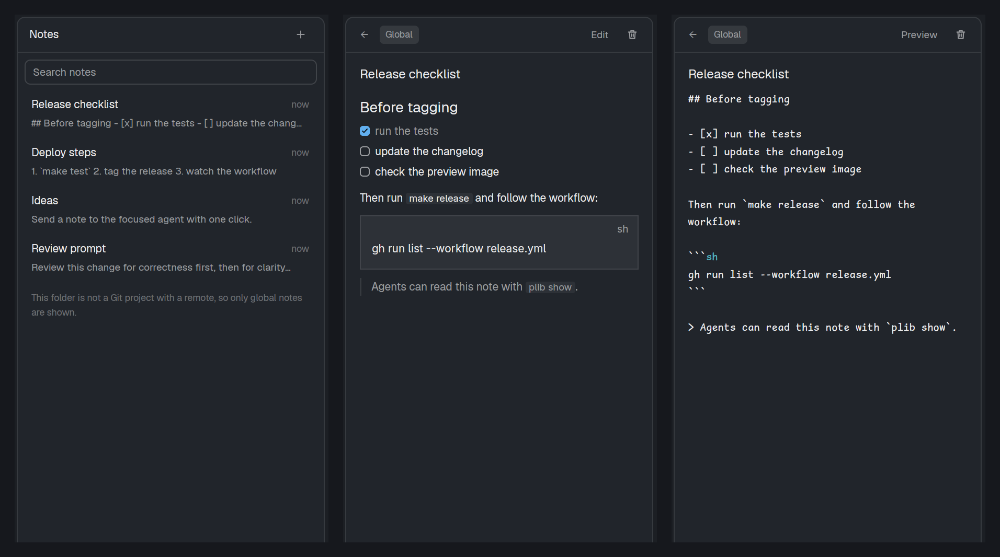

# Herdr Notes

Project notes in a Herdr side panel, shared with your agents.

A native [Herdr](https://herdr.dev) mod that shows the notes of the project
you are working in, next to Files and Changes. Notes are stored in
[Project Library](https://github.com/illegalstudio/project-library) (`plib`),
so the coding agents in your terminals read and write the same notes through
the plib CLI and its bundled skill. It also works for spaces on other machines.



## Requirements

- The **new Herdr desktop app**, with JavaScript / gpui-kit mods. This is not
  a plugin for the legacy Herdr TUI.
- [plib](https://github.com/illegalstudio/project-library#installation)
  **0.1.4 or newer** on every machine whose spaces should show notes, with an
  initialized library (`plib init --local` or `plib init --remote URL`).
- For agents: the plib skill on each machine where they run
  (`plib skills install`). The panel tells you when it is missing or stale.
- To share notes between machines: a Git remote for the library
  (`plib remote set URL`) on each of them.

## How it works

The panel follows the focused pane, like Files. plib decides the project from
that folder's Git remote, so you see that project's notes plus your global
ones. A folder without a portable Git remote shows global notes only.

For a space on another machine, plib runs **on that machine**. The panel and
the agents working there use the same library, and an agent's new note shows
up in the panel within seconds. Machines converge through plib's own Git
synchronization.

The panel never writes the library folder itself. It runs `plib list`,
`add`, `edit` and `delete`, always with the note's revision, so an edit made
by an agent while you type is never overwritten quietly.

## Install with your agent

Give your agent this prompt:

> Read ~/.config/herdr-app/AGENTS.md, then install the mod from
> https://github.com/illegalstudio/herdr-notes. Read RECIPE.md and the source
> files first. Add Notes as a third side panel beside Files and Changes,
> preserving my current layout. Clone the layout and the tab bar first if
> they are shipped by Herdr. This mod runs plib on this computer and on the
> machines of my remote spaces, and reads and writes my plib note library
> through it.

## Manual install

Copy the mod into Herdr's home (the command refuses to overwrite):

```sh
git clone https://github.com/illegalstudio/herdr-notes.git
cd herdr-notes
home="${HERDR_APP_HOME:-$HOME/.config/herdr-app}"
[ -e "$home/mods/herdr-notes" ] || cp -R mods/herdr-notes "$home/mods/herdr-notes"
herdr-app check "$home/mods/herdr-notes"
```

`mod.json` uses `"place": "none"`, so copying changes nothing on screen. Pick
one of the placements below.

### As a side panel

The Files and Changes buttons belong to Herdr's tab bar mod, which is
read-only. Use a personal layout and a cloned tab bar:

```sh
herdr-app do layout.clone '{"name":"main","as":"my-layout"}'
herdr-app do mod.clone '{"name":"tabs","as":"my-tabs"}'
```

In `layouts/my-layout.json`, point the `tabs` block to `my-tabs` and add a
third block to the `panel-body` stack:

```json
{ "id": "notes", "type": "block", "content": { "mod": "herdr-notes" } }
```

In `mods/my-tabs/main.js`, accept the new panel and draw its button:

```js
const enabled = [...(shared("workspace.panels") ?? ["files", "changes"]), "notes"];
// ... after the Changes button:
.when(Boolean(find(root, "notes")), el => el.child(panelButton("notes", "Notes", "mods/herdr-notes/note.svg")))
```

### As a pane or a tab

No layout change is needed:

```sh
herdr-app do pane.split '{"direction":"right","mod":"herdr-notes"}'
herdr-app do tab.new '{"name":"Notes","mod":"herdr-notes"}'
```

## Using the panel

- **+** starts a note. It is saved as you type, about a second after you
  stop. A note without a title takes its first line as the title.
- Click a note to open it. **Preview** renders its Markdown, **Edit** goes
  back to the source. The choice stays as you move between notes and across
  restarts; only a note you are writing for the first time always opens in
  the editor. `Ctrl+S` saves at once, `Escape` or **←** returns to the list.
  `Ctrl+V` pastes, and so does `Ctrl+Shift+V` (what Omarchy's Super+V sends).
- The chip beside **←** shows the note's scope. Click it to move the note
  between the project and Global.
- The copy icon puts the note's Markdown on your clipboard (its title when
  the note has no body) and shows a check for a moment. In the list it takes
  the place of a row's age while the pointer is on that row. In an open note
  it sits in the header and copies the text as you see it, including edits
  not saved yet.
- The trash icon asks once, then deletes.
- Search matches titles and bodies. In a project, the chips filter All,
  the project, or Global.
- The footer shows the machine, the note count and the synchronization
  state. Click the state to synchronize now.

When a note changes somewhere else while you edit it, the panel says so and
lets you keep your version or load the other one. If that happens after you
already left the note, your text is saved as a second note named
"... (my version)".

## Agents

Agents do not talk to this mod. They use plib directly, guided by its skill:

```sh
plib skills install     # on each machine where agents run
plib list --json        # what an agent runs to find notes
```

Ask an agent to "read the project notes" or "add a note about X" and it
will use the same library the panel shows.

## Commands and keys

`herdr-notes.new` starts a note, `herdr-notes.back` returns to the list
(saving first) and `herdr-notes.focus` moves the keyboard to the search
field, in a shown copy of the panel:

```json
{ "global": { "ctrl-alt-n": "herdr-notes.new" } }
```

## Development

```sh
herdr-app check mods/herdr-notes
node --test tests/test_plib.mjs tests/test_plib_cli.mjs
```

The second test file runs the panel's real argument lists against the
installed plib in a throwaway library, and is skipped where plib is missing.
To try the panel on a throwaway library, give the block
`"props": { "home": "/path/to/library" }`; it is passed to plib as `--home`.

To develop against the running app, link the folder instead of copying it:
`ln -s "$PWD/mods/herdr-notes" ~/.config/herdr-app/mods/herdr-notes`. Herdr
does not notice edits made through the link, so remove and recreate the link
to reload the mod after each change.

After changing the UI, also open it in Herdr: the check covers only the
first render. See [RECIPE.md](RECIPE.md) for composition and acceptance checks.

## Release

From a clean `main` branch that has been pushed to `origin`, run:

```sh
make release
```

The command fetches tags, proposes the next patch version (starting at
`v0.1.0`), and accepts a custom `vMAJOR.MINOR.PATCH` version with or without
the `v`. After confirmation it creates an annotated tag at the displayed commit
and pushes the tag to `origin`.

The GitHub **Release** workflow runs the JavaScript tests, packages the mod as
`.zip` and `.tar.gz`, and publishes those archives with SHA-256 checksums and
generated release notes. Archives contain the `mods/herdr-notes` folder, the
installation docs, recipe, preview and license from the tagged commit.
Generated Herdr files stay out of the archives. Follow the workflow with
`gh run list --workflow release.yml`.

## Remove

Remove the `notes` block from your layout and the button from your tab bar,
then delete `mods/herdr-notes`. Your notes stay in plib.

## License

[MIT](LICENSE).
