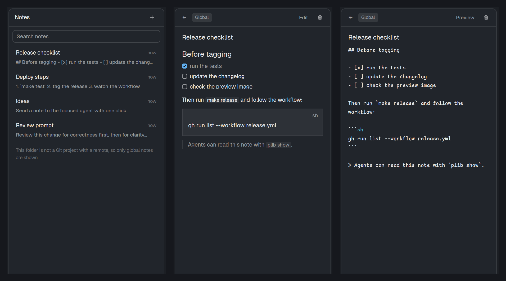

# Herdr Notes

A side panel of notes for the project the focused pane is in, beside Files
and Changes. Notes live in Project Library (`plib`), so the agents in the
terminals read and write the same ones. Works for spaces on other machines.

## What you see

A card like Files: 1 px border, 10 px radius, theme `background`.

List view, top to bottom: a 42 px header with **Notes**, the project name
(dim, right) and a **+** button; optional banners; a 30 px search field; in a
project, three chips (All, the project name, Global); the notes, newest edit
first, each a row with the title, a scope tag, the age (`now`, `5m`, `3h`,
`2d`, `Nov 2`) and one line of the body; while the pointer is on a row, a
20 px copy icon takes the age's place without moving anything; a fixed footer below the list with the
machine name, the note count and the synchronization state on a 26 px line
and, above it, one dim line ("No Git remote here: global notes only.") when
the folder is not a Git project with a remote.

Note view: a 42 px header with **←**, a scope chip (accent for project),
the save state (dim, right), **Preview** or **Edit**, and a trash icon that
becomes **Delete** and **Cancel**; optional banners; a 15 px semibold title
field; the body as a plain textarea in the terminal font (soft wrap), or
rendered Markdown in Preview.

Full-panel messages replace the list when plib is missing on that machine
(install commands and a button to the guide), is older than 0.1.4, has no
library yet (a **Create library** button) or failed (the error and
**Check again**).

## How it behaves

The panel follows the focused pane's folder and machine. A changed folder
shows that project's notes plus global ones; a folder without a portable Git
remote shows global notes and says why in the footer.

Typing saves after 1.2 s of quiet, on blur, on `Ctrl+S` and when leaving the
note. An empty title takes the body's first line and follows it until a
title is typed. Leaving with **←** or `Escape` saves first. Edit or Preview
is one remembered choice for every note; a note being written for the first
time opens in the editor regardless. Clicking the scope chip moves the note between the
project and Global.

The copy icon writes the note's body (its title when the body is empty) to
this computer's clipboard with `cx.write_to_clipboard`, also for notes of a
remote space, and turns into a green check for 1.5 s. On a row it does not
open the note. It does not update plib's last-used time.

A note changed elsewhere while open and untouched updates in place. Changed
while edited, a banner offers **Keep mine** or **Load the other version**.
Deleted elsewhere, a banner offers **Save it again** or **Discard**. If a
save conflicts after the note was closed, the text is saved as a second note
"<title> (my version)" and a toast says so.

A banner appears when the plib skill on that machine is missing or stale,
with `plib skills install`, **Copy**, **Check again** and **Dismiss**
(remembered per machine and state). A hand-edited skill is only reported.

Agent states (working, blocked, done, idle) do not change the panel. Agents
reach the notes through plib, not through this mod.

## Built from

- `mods/herdr-notes/main.js` exports a gpui-kit `View` using `v_flex`,
  `h_flex`, `InputState` + `Input`, `TextareaState` + `Textarea`,
  `TextView.markdown`, and from `herdr`: `spaces`, `panes`, `focused`,
  `exec`, `watchFolder`, `layout`, `theme`, `settings`, `notify`,
  `nextCommand`, `props`.
- `mods/herdr-notes/plib.js` holds every plib argument list and result
  parser, with no Herdr imports.
- Programs: `plib` only, through `exec("plib", args, { cwd, on })` on the
  space's machine: `status --json`, `list --json --no-sync`,
  `add|edit|delete ... --json --no-sync` with `--if-match`, `sync`,
  `init --local`, `skills verify --json`, `--version`. Plus `xdg-open` or
  `open` for the installation guide.
- `mod.json`: `{ "place": "none", "title": "Notes", "focusable": true }`.
- As a side panel: a block `{ "id": "notes", "content": { "mod": "herdr-notes" } }`
  in the `panel-body` stack of a personal layout, and one more `panelButton`
  in a cloned `tabs` mod that also accepts `notes` in its enabled list.
  Clone shipped layouts and mods first; never edit them.
- Mod commands: `herdr-notes.new`, `herdr-notes.back`, `herdr-notes.focus`.
- Props: `{ "home": "/path" }` passes `--home` to plib, for previews and tests.

Before installing, disclose that this mod runs plib on this computer and on
the machines of remote spaces, and reads and writes the plib note library.

## Watch out

- `exec` has no standard input: the body travels as one `--body=` argument,
  so notes above 100 KB are refused by the panel.
- plib older than 0.1.4 lacks `edit`, `delete`, `status`, `--no-sync` and
  revisions; the panel refuses it instead of degrading.
- Reads must use `--no-sync`, or every poll does a Git fetch.
- Compare editor text with what the editor returned when the note was
  loaded, not with plib's body: an editor may normalize text.
- Create `InputState` and `TextareaState` in handlers, never in `render`, and
  release them when the note closes.
- `set_value` on an input or editor does not fire `change`: after loading
  another version into the fields, update the saved-state snapshot yourself.
- The text fields paste only on Ctrl+V (Cmd+V on macOS). Omarchy's Super+V
  reaches Herdr as Ctrl+Shift+V, so the panel catches that chord and inserts
  the clipboard with `replace` into the focused field. Herdr's `EditorState`
  has no such insertion call and a mod cannot dispatch the native paste
  action, which is why the body is a textarea and not the code editor.
- A list read that started before a write finished must be discarded, or it
  puts the old text back into the open editor.
- Herdr does not hot-reload a mod folder that is a symlink: recreate the
  link after each change while developing.
- A hidden copy keeps its timers: poll only while the block is shown.
- `watchFolder` is local only; remote spaces rely on the 10 s poll. Ignore
  changes under the library's `.git`.
- A missing folder and a missing program fail the same way on a remote
  machine: retry from the home folder before saying plib is missing.
- Project scope needs a portable Git remote on the folder.

## Done when

- `herdr-app check mods/herdr-notes` passes and `herdr-app status` reports
  no mod errors with the panel open.
- `node --test tests/test_plib.mjs tests/test_plib_cli.mjs` passes.
- The Notes button toggles the panel like Files and Changes, and the choice
  is remembered per space.
- Focusing a pane in another project changes the list; a remote space lists
  that machine's notes or explains what is missing there.
- A new note appears in `plib list` on that machine, an edit made with
  `plib edit` shows up in the open panel, and a concurrent edit raises the
  banner instead of overwriting.
- Delete asks once and removes the note from `plib list`.
- With the skill missing, the banner shows the command and disappears after
  installation and **Check again**.
